# Garen FIT RAMP gate + Shelly Plus Uni

[🇪🇸 Español](README.md) · 🇬🇧 English

Automation of a gate driven by a **Garen FIT RAMP V2.2** control board using a **Shelly Plus Uni**:
open it from the phone and from **Apple CarPlay**, read the **open / closed / halfway** state from the
real limit switches, and get a **push alert** if the gate is left open.

No extra components: the Shelly is powered by the board itself and connected with 7 wires.

| Before | After |
|---|---|
| 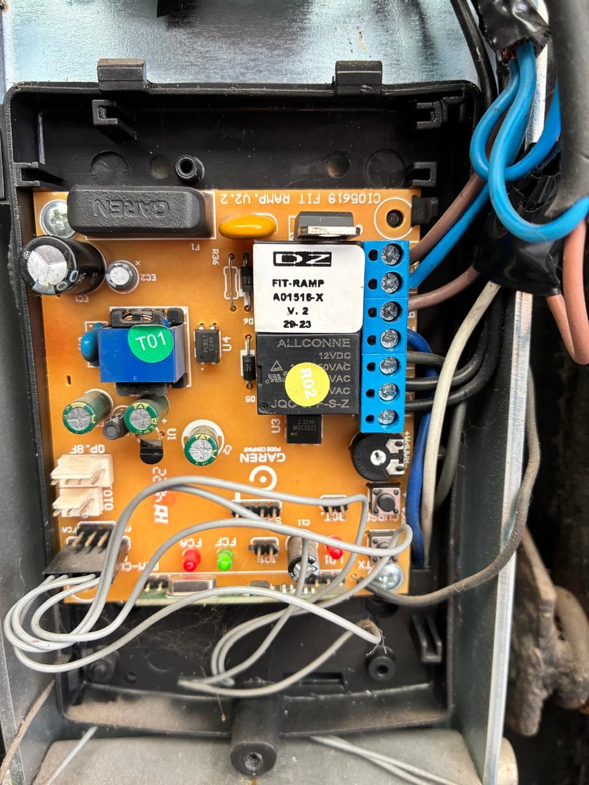 | 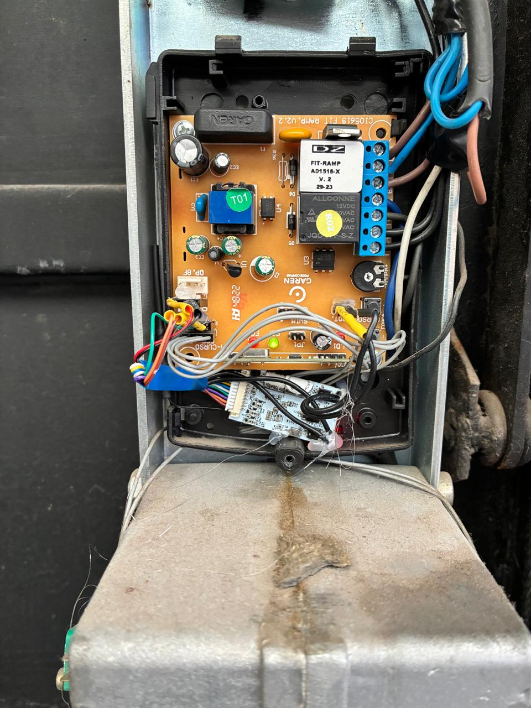 |

---

## Contents

- [Hardware](#hardware)
- [Board measurements](#board-measurements)
- [Wiring](#wiring)
- [Shelly configuration](#shelly-configuration)
- [Detecting open / closed](#detecting-open--closed)
- [Scripts](#scripts)
- [Push alerts (ntfy)](#push-alerts-ntfy)
- [CarPlay](#carplay)
- [Siri](#siri-hey-siri-open-the-gate)
- [WiFi and recovery](#wifi-and-recovery)
- [Lessons learned](#lessons-learned)
- [Warning](#warning)

---

## Hardware

| | Details |
|---|---|
| Control board | **Garen FIT RAMP V2.2**, label `FIT-RAMP A01516-X`, silkscreen `CI05619 FIT RAMP V2.2` |
| Variants | `A01516` = DZ (sliding) and `A01518` = BV (tilting/overhead) are the **same board**; only the BV/DZ jumper changes |
| Manual | [manual_central_fit_ramp.pdf](https://docs.garen.com.br/manuais/manual_central_fit_ramp.pdf) (Portuguese/Spanish) |
| Module | **Shelly Plus Uni** (Gen2), stock firmware 2.0.1 |
| Extras | Female Dupont wires, heat shrink |

### Why the Shelly Plus Uni?

It matches the board directly, nothing to adapt:

| Need | Shelly Plus Uni | Garen board |
|---|---|---|
| Power | 9–28 V DC | FOTO connector: **12 V** |
| Pulse to BOT | 2 potential-free outputs (max 30 V / 0.3 A) | BOT: **5.2 V** |
| Read limit switches | 2 digital inputs | FCA / FCF: **0 V** active, **~5 V** idle |
| App and CarPlay | Shelly Smart Control app (cloud) | — |

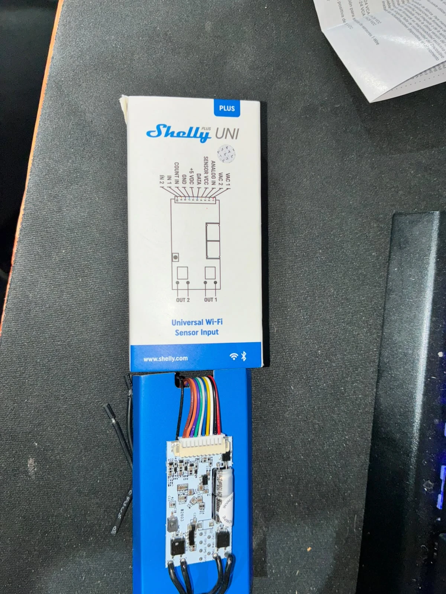

---

## Board measurements

DC multimeter, reference = board ground (negative pin of the FOTO connector).

**FOTO connector** (order `− signal +`): **12 V** between + and −.

**FIM-CURSO** (limit switches): the board has **two parallel headers**. The motor uses one; the
other is free and is where the Shelly connects. **Middle pin = GND**.
FCA = *fim de curso de abertura* (open limit), FCF = *fim de curso de fechamento* (closed limit).

| Gate | FCF | FCA | LED |
|---|---|---|---|
| Closed | 0 V | ~5 V | FCF (green) |
| Halfway | 4.7 V | 4.7 V | none |
| Open | 4.7 V | 0 V | FCA (red) |

**BOT** (2 pins, external push button): the pin marked with a **dot = signal (5.2 V)**, the other = GND.
Shorting them for ~**1 second** is the same as pressing the button. Cycle:
**open → stop → close → stop → open**. Shorter pulses are ignored by the board.

**Travel time**: ~**12 s** each way.

The motor limit switches are **mechanical microswitches** actuated by a cam.

| FIM-CURSO headers on the board | Limit switch on the motor |
|---|---|
| 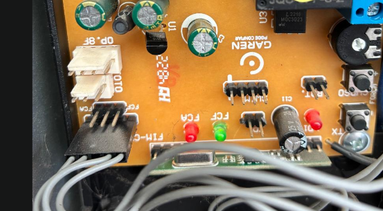 | 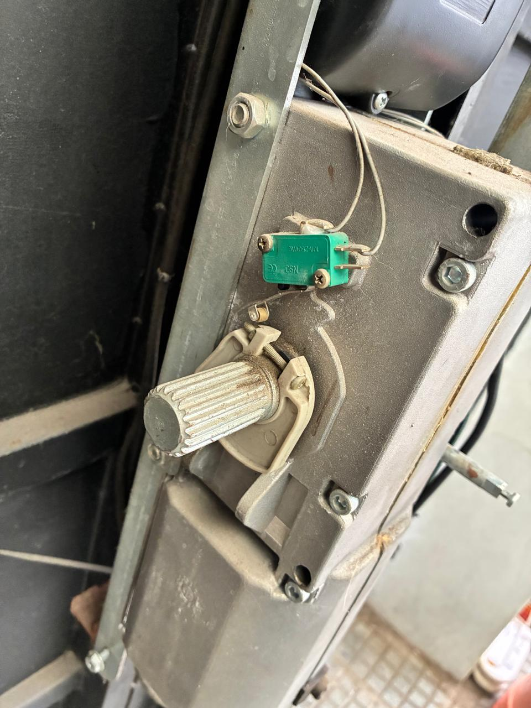 |

---

## Wiring

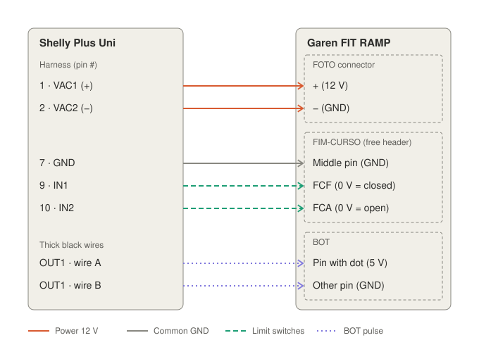

| Shelly Plus Uni | Garen board |
|---|---|
| Harness **1 · VAC1** | FOTO **+** (12 V) |
| Harness **2 · VAC2** | FOTO **−** |
| Harness **7 · GND** | Free FIM-CURSO header, **middle pin** |
| Harness **9 · IN1** | Free FIM-CURSO header, **FCF** |
| Harness **10 · IN2** | Free FIM-CURSO header, **FCA** |
| **OUT1** (2 thick black wires) | The 2 **BOT** pins (no polarity) |

Notes:

- **GND (pin 7) is required**: IN1/IN2 are referenced to pin 7, not to VAC2
  (VAC1/VAC2 accept AC and go through an internal rectifier).
- Unused wires: **3, 4, 5, 6, 8** and the two black **OUT2** wires. Insulate each one.
  ⚠️ **4 (SENSOR VCC)** and **6 (+5 V)** are **power outputs**: touching ground shorts them.
  Insulate them well or cut them.
- Female **Dupont** wires were soldered to the harness: nothing is soldered on the Garen board.
- The Shelly sits inside the control box, fixed so it cannot touch the board or the chassis.
  WiFi signal inside the metal motor housing: **-62 to -65 dBm**.

### Build photos

| Prepared harness (Dupont + heat shrink) | |
|---|---|
| 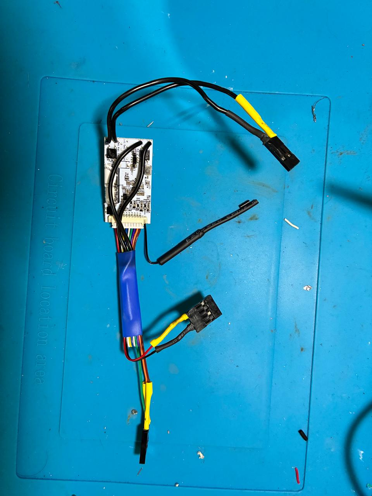 | 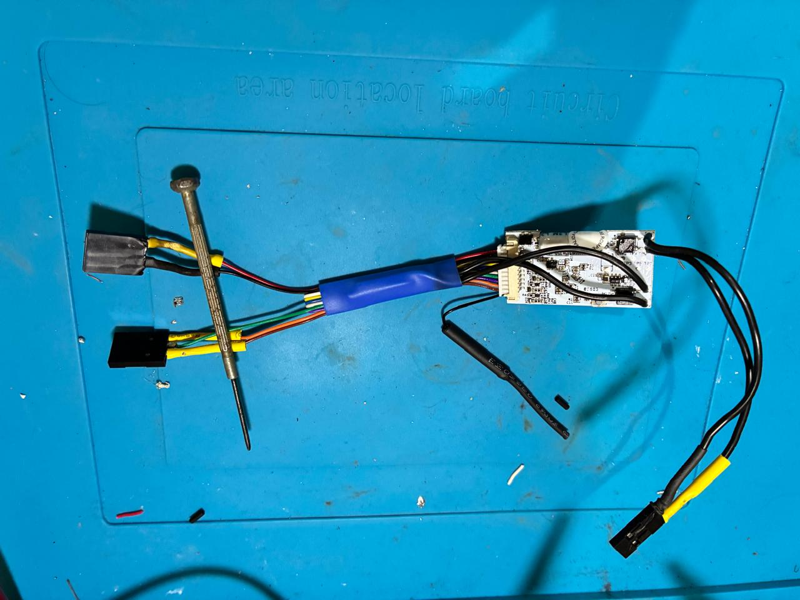 |

| FIM-CURSO and FOTO connected | BOT connected |
|---|---|
| 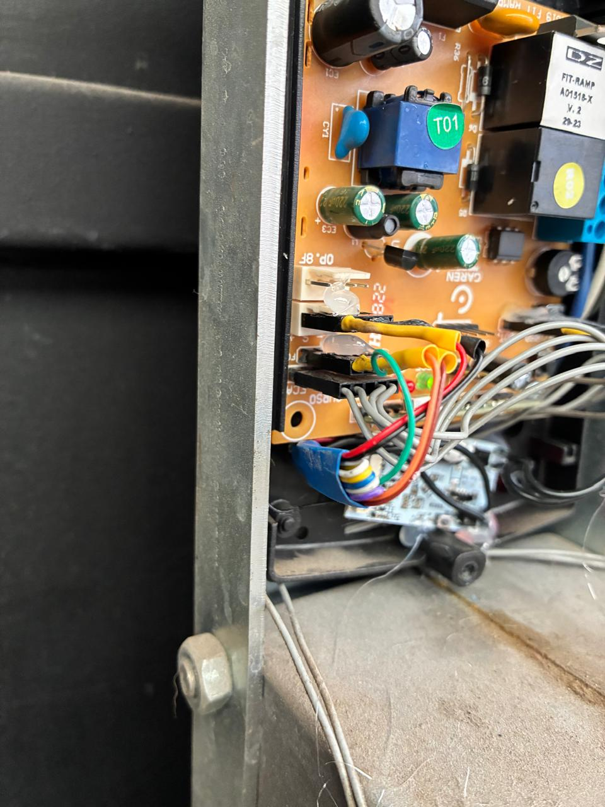 | 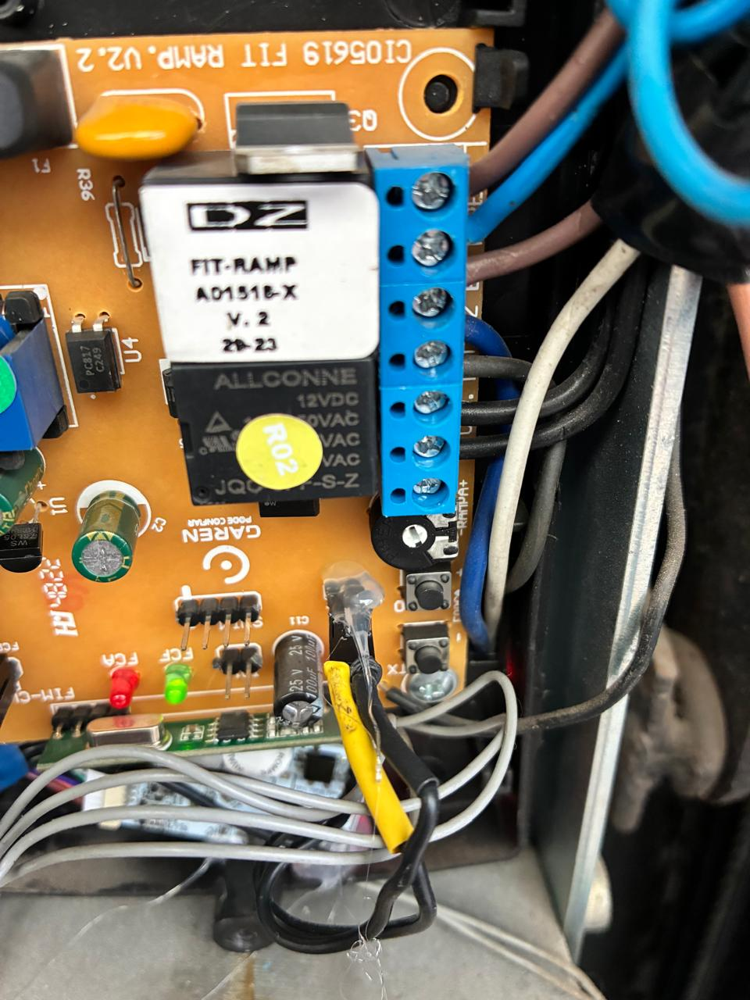 |

---

## Shelly configuration

**Stock Shelly firmware** (no alternative firmware needed).

| Component | Configuration |
|---|---|
| OUT1 (`switch:0`) "Portón" | `in_mode: detached`, `auto_off: true`, `auto_off_delay: 1.0`, `initial_state: off` |
| OUT2 (`switch:1`) | `in_mode: detached`, `initial_state: off` — used as a state indicator (see below) |
| IN1 (`input:0`) "Cerrado (FCF)" | `invert: true` |
| IN2 (`input:1`) "Abierto (FCA)" | `invert: true` |
| COUNT (`input:2`) | `enable: false` |
| WiFi | Primary network (gate) + backup network; password-protected AP |

Everything can be applied over RPC from the local network (replace `IP`):

```bash
curl -X POST -d '{"id":1,"method":"Switch.SetConfig","params":{"id":0,"config":{"name":"Porton","in_mode":"detached","initial_state":"off","auto_off":true,"auto_off_delay":1.0}}}' http://IP/rpc
curl -X POST -d '{"id":1,"method":"Switch.SetConfig","params":{"id":1,"config":{"in_mode":"detached","initial_state":"off"}}}' http://IP/rpc
curl -X POST -d '{"id":1,"method":"Input.SetConfig","params":{"id":0,"config":{"name":"Cerrado (FCF)","invert":true}}}' http://IP/rpc
curl -X POST -d '{"id":1,"method":"Input.SetConfig","params":{"id":1,"config":{"name":"Abierto (FCA)","invert":true}}}' http://IP/rpc
curl -X POST -d '{"id":1,"method":"Input.SetConfig","params":{"id":2,"config":{"enable":false}}}' http://IP/rpc
```

> ⚠️ **Important:** out of the box the outputs are in `follow` mode (the input drives the relay).
> With this wiring the Shelly would **hold BOT pressed** whenever the gate reaches a position, and
> the gate would move on its own. Set `detached` **before** connecting BOT.

---

## Detecting open / closed

The Plus Uni inputs read **"on" when voltage is present**. Since the limit switches give **0 V when
active**, both inputs must be **inverted**.

States verified with the gate running:

| Closed (FCF) | Open (FCA) | State |
|---|---|---|
| on | off | **Closed** |
| off | on | **Open** |
| on | on | **In between** (moving or stopped halfway) |

- "Moving" and "stopped halfway" cannot be told apart from the inputs alone. Since travel takes
  ~12 s, if "in between" lasts more than ~30 s the gate is stopped.
- The **direction** can be inferred: leaving closed means opening; leaving open means closing.
- With a multimeter (Shelly disconnected) halfway reads 4.7 V; with the Shelly connected those
  lines read as "no voltage". It does not affect operation.

### State indicator and smart button

The Shelly app shows the outputs but not `detached` inputs. So **OUT2** (wired to nothing) is used
together with [`watchdog-state.js`](scripts/watchdog-state.js):

- **Indicator:** OUT2 stays **on while the gate is not closed** and off when closed. Its name on
  the Shelly changes to `Estado: cerrado / abierto / a mitad` (visible in the channel settings; the
  app dashboard uses its own name).
- **Smart button:** turning OUT2 on **opens** the gate (only if closed); turning it off **closes**
  it (only if open). Halfway it does nothing, since the direction of the next pulse is unknown.
  After each command it goes back to showing the real state.

The app shows two cards: rename them to **"Gate"** (OUT1, plain pulse) and **"Gate open"**
(OUT2, indicator and smart button).

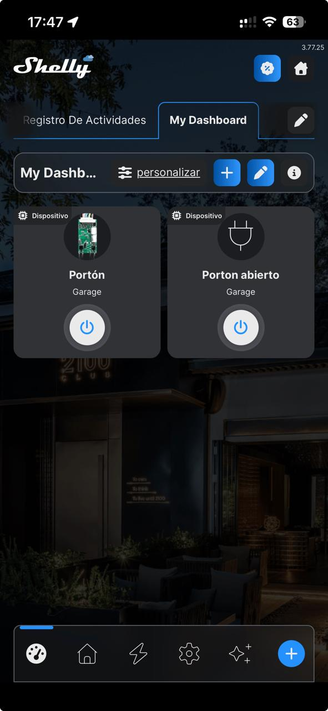

---

## Scripts

The Plus Uni allows **at most 3 running scripts**. Load them from the Shelly web UI
(**Scripts → Create**), paste, then **Enable** (run on boot) and **Start**.

| Script | What it does |
|---|---|
| [`ap-rescue.js`](scripts/ap-rescue.js) | After 5 min unable to join any WiFi network, turns on the Shelly AP **with a password**. Turns it off once reconnected. |
| [`watchdog-state.js`](scripts/watchdog-state.js) | **Watchdog**: if OUT1 stays on for more than 2-3 s (auto-off failure), turns it off. **Indicator and smart button** on OUT2. |
| [`open-alert.js`](scripts/open-alert.js) | ntfy push alert if the gate is **not closed** for more than 5 min; repeats every 15 min and notifies when it closes. |

Before loading them, change `AP_PASS` in `ap-rescue.js` and `TOPIC` in `open-alert.js`.

---

## Push alerts (ntfy)

[ntfy](https://ntfy.sh) is free and needs no account:

1. Install the **ntfy** app (iOS / Android).
2. Subscribe to a **random, private** topic (e.g. `gate-` + random characters).
   Anyone who knows the name can read the alerts.
3. Put that topic in `TOPIC` in `open-alert.js`.

Enable this script **after** verifying the inputs: if they are inverted the wrong way, a closed gate
looks open and you get false alerts.

---

## CarPlay

The **Shelly Smart Control** app has native CarPlay support and works through the cloud (no Apple
Home hub needed): **Settings → App Settings → CarPlay Devices → Edit** and pick the cards.
See the [official guide](https://support.shelly.cloud/en/support/solutions/articles/103000308601-add-shelly-devices-to-apple-carplay).

Apple Home (HomeKit) was not used: the Plus Uni on stock firmware is not compatible, and remote
access would require a hub (HomePod or Apple TV).

---

## Siri ("Hey Siri, open the gate")

Using the iPhone **Shortcuts** app, one shortcut per command, through Shelly's
[Cloud Control API](https://shelly-api-docs.shelly.cloud/cloud-control-api/). Since the logic lives
on the Shelly (smart button on OUT2), each shortcut has only two actions:

1. **Get Contents of URL**
   - URL: `https://<server>.shelly.cloud/device/relay/control`
   - Method: **POST** · Request body: **Form**
   - Fields: `id` = device ID, `auth_key` = cloud key, `channel` = `1`,
     `turn` = `on` (open) / `off` (close)
2. **Speak Text**: "Command sent".

The server and key are in the Shelly app (Settings → Home → Access and permissions → Cloud key).
The device ID is the Shelly MAC address in lowercase.

- It must be **POST with the data in the body** (Request Body → Form):
  - with GET (data in the URL) the API answers `wrong_channel`;
  - with the fields under **Headers** it answers `invalid_token` / `invalid_header`, even with the
    right key (both sections sit next to each other in Shortcuts, easy to mix up).
- Run each shortcut once on the phone and choose **Always Allow**; otherwise iOS cannot show the
  permission prompt while driving.
- The cloud key controls **all** your devices: do not share it.

---

## WiFi and recovery

Three layers so the Shelly never has to be taken out:

1. **WiFi 1** = gate network, **WiFi 2** = backup network (e.g. the phone hotspot with a fixed
   name and password).
2. **`ap-rescue.js`**: after 5 min without WiFi the Shelly creates its own network (password
   protected). Connect and open `http://192.168.33.1` to enter the new network.
3. Last resort: reset by power cycling (switch the control board power off and on).

---

## Lessons learned

- **Factory `follow` mode is dangerous** with this wiring: set `detached` before connecting BOT.
- **The inputs read the opposite way** from what the Uni documentation suggests: they had to be inverted.
- **Double tap in the app**: the pulse lasts 1 s; tapping again while it is on turns it off instead
  of sending another pulse. Wait for the button animation to finish.
- **The cloud API may return stale input states**: to verify, read locally
  (`http://IP/rpc/Input.GetStatus?id=0`).
- **Removing the device from the app does not reset it**: WiFi, configuration and scripts are kept;
  just add it again.
- The app uses **its own names** for each channel, not the name set on the Shelly.
- **A watchdog must never be able to cut valid pulses**: the first version turned OUT1 off whenever a
  periodic check found it on, even in the middle of a normal 1 s pulse. It now acts only if the
  output is still on for 3 consecutive checks.
- **Cloud API**: commands (`/device/relay/control`) require POST with a form body.
- **Remote diagnostics**: `watchdog-state.js` has `DEBUG_TOPIC`; set it to an ntfy topic to receive
  every event (command and its source, pulse, duration in ms, limit switches). It helped find
  issues without local network access. Leave it empty in normal use.

Pulses measured with the shortcut: the output is turned off by the timer (`timer`) at ~1000 ms and
the gate travels in ~14 s.

---

## Warning

The control board runs on **mains voltage (220 V)**. Cut the power before connecting or
disconnecting anything. Personal project, not affiliated with Garen or Shelly; use at your own risk.

## License

[MIT](LICENSE)
